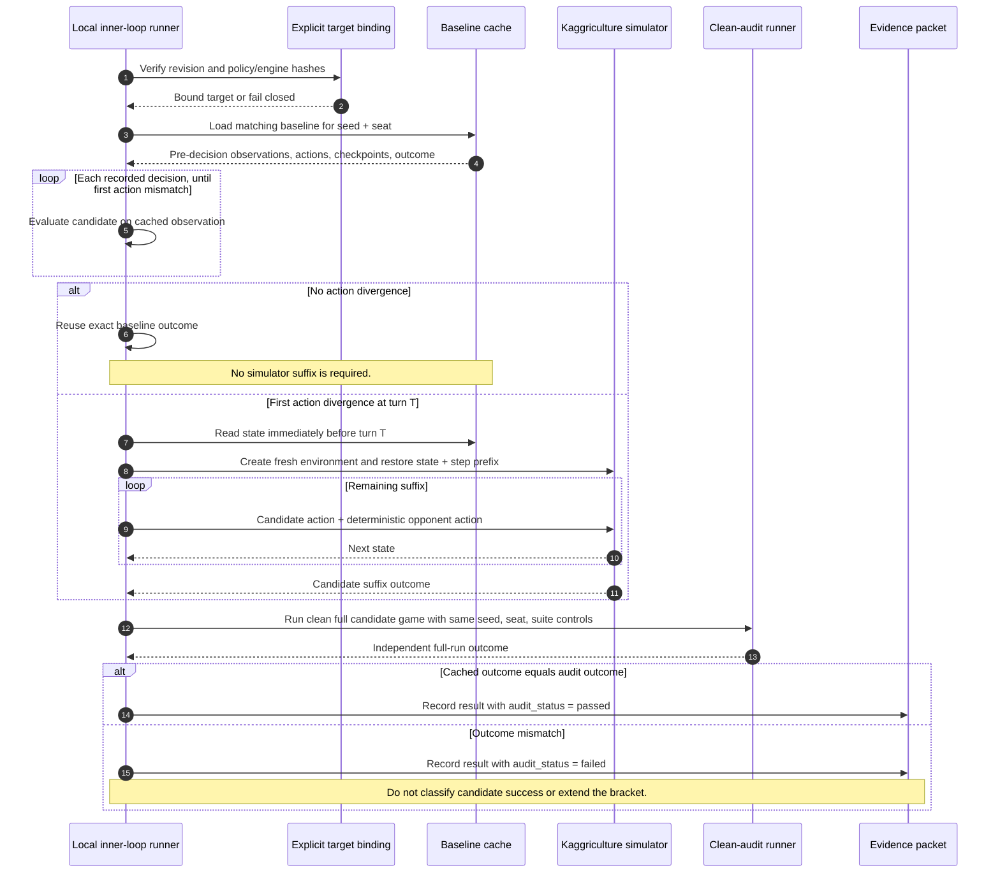
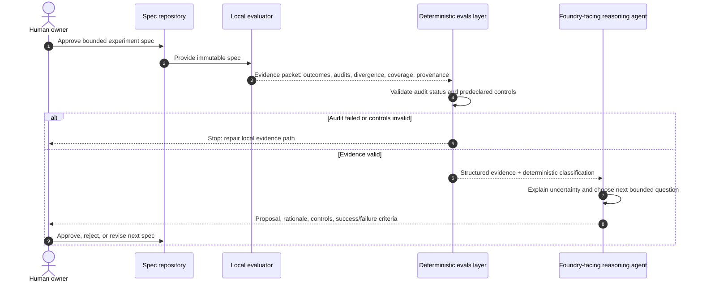
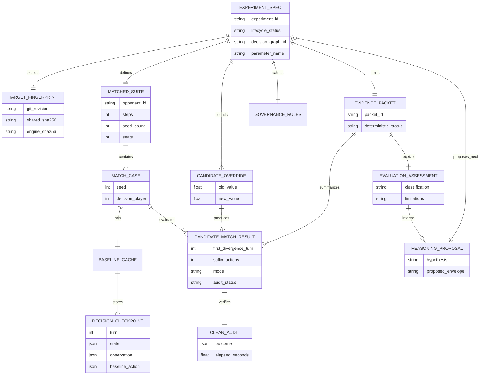
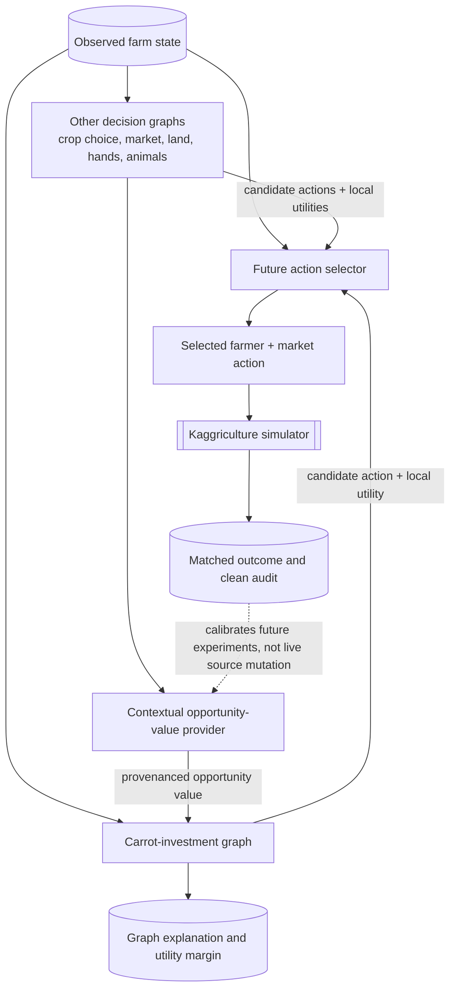
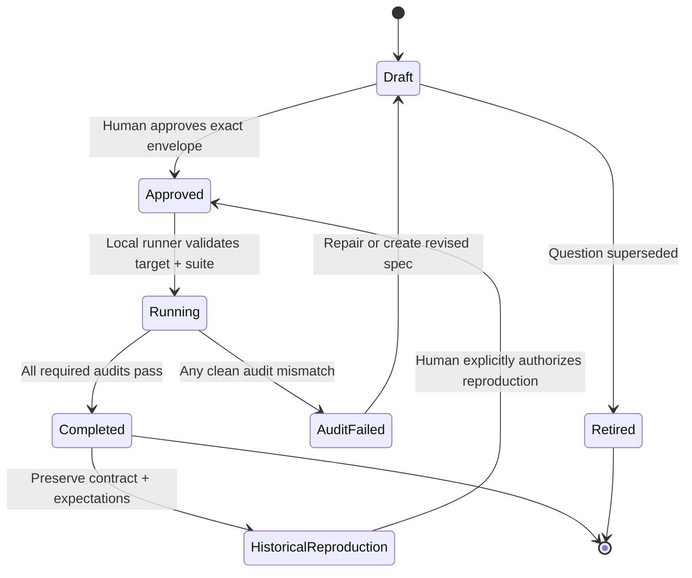
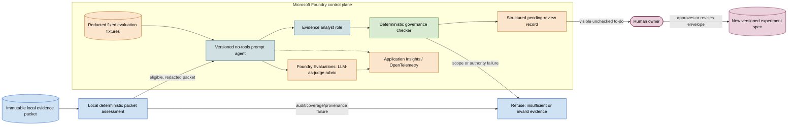

# Carrot tuning system: architecture diagrams

These diagrams are a visual companion to the detailed
[continuity guide](../README.md), not an alternative specification. They show
which component is allowed to make which kind of decision. In particular, the
local evaluator is the score authority; Foundry-facing components interpret
evidence and propose bounded next experiments, but never overwrite local audit
status or edit Kaggriculture policy source.

## 1. System context: two loops, one human governance boundary

```mermaid
flowchart LR
    Human([Human owner])
    Spec[(Versioned experiment specification)]

    subgraph Local[Local deterministic evidence plane]
        Validate[Validate spec and explicit target binding]
        Baseline[(Immutable baseline cache)]
        Fast[Checkpoint replay and restored suffix]
        Audit[Clean full-suite audit]
        Packet[(Evidence packet)]
        Target[[Kaggriculture system under test]]

        Validate --> Baseline
        Validate --> Fast
        Baseline --> Fast
        Fast <--> Target
        Fast --> Audit
        Audit <--> Target
        Audit --> Packet
    end

    subgraph Outer[Outer evals and reasoning plane]
        Evals[Evaluate audit status, coverage, and paired results]
        Reasoner[Reasoning agent: explain and propose]
        Proposal[(Bounded next-experiment proposal)]

        Evals --> Reasoner --> Proposal
    end

    Human -->|approves bounded envelope| Spec
    Spec --> Validate
    Packet --> Evals
    Proposal -->|human reviews| Human
    Human -.->|only human applies a reviewed change| Target

    classDef authority fill:#d9ead3,stroke:#38761d,color:#000;
    classDef evidence fill:#cfe2f3,stroke:#1155cc,color:#000;
    classDef future fill:#fce5cd,stroke:#b45f06,color:#000;
    class Human authority;
    class Validate,Baseline,Fast,Audit,Packet,Target evidence;
    class Evals,Reasoner,Proposal future;
```

The dashed human-to-target edge is intentionally not an automation path. It
means that an actual source-policy change requires a separate human decision
after reviewing evidence.

## 2. Inner-loop sequence: one candidate against one matched game

The restore includes the simulator's completed step-prefix placeholders as
well as state. That detail prevents the engine from silently restarting its
internal step numbering after restoration.

## 3. Outer-loop interaction: evidence before reasoning

The reasoning agent receives a structured evidence packet, not raw simulator
state or authority to alter results. The deterministic evals layer can block a
proposal when audits fail.

## 4. Core entities and their relationships

This is a conceptual entity diagram, not a database schema. It identifies
records that need stable identities and provenance once the mocked notebook is
replaced by the real inner-loop runner.

The key relationship is `CANDIDATE_MATCH_RESULT → CLEAN_AUDIT`: a fast result
is not standalone evidence. Its audit establishes whether it may be included
in an evidence packet at all.

## 5. Decision-graph interaction: carrots today, multiple graphs later

Today, `seed_opportunity_value` is a static carrot parameter. Later, it can be
the typed input from `Context`, representing a credible competing use of seed,
tile, money, farmer time, or near-future action capacity. The carrot graph
continues to estimate carrot return; it should not quietly become the whole
farm planner.

## 6. Experiment lifecycle and immutability

An executed specification is never edited to create a new question. A changed
candidate envelope, suite, target revision, or acceptance rule gets a new
versioned specification. Historical records preserve the exact controls and
expected classification that a future runner must reproduce.

## 7. Foundry control plane: deployed analyst, planned judge and review

This is the source-controlled Foundry vertical slice. The no-tools Workflow /
Analyst path is deployed and has one accepted redacted smoke response; the
Evaluation/Judge, Review, and richer Trace analysis remain future or blocked
work. The important distinction is between an LLM used to *generate or judge
language* and deterministic components that retain mechanical authority.

The first deployment is one no-tools prompt agent, not a hidden multi-agent
workflow. The evidence analyst may restate only packet-cited facts; the
deterministic gate rejects invalid output regardless of how persuasive the
model response sounds. A planner or governance role can be added later only
through its own reviewed contract and approval; it is not implied by the first
analyst deployment.

Foundry Evaluations provides the LLM-as-judge layer for fixed test fixtures.
Its rubric should score whether an analyst response is grounded in the supplied
packet, honestly labels a one-seed smoke run as inconclusive, respects the
declared envelope, names a falsifiable success criterion, and preserves the
human-review requirement. It is not allowed to assign a game score, deem a
candidate mechanically audited, or approve a policy mutation.

Tracing records only redacted operational provenance—packet ID/hash, contract
and agent versions, role transition, decision status, and refusal reason. Raw
checkpoint state, the sibling checkout, credentials, and policy-writing tools
are outside the Foundry boundary.

## How to use these diagrams

- Start with diagrams 1 and 3 when returning after an interruption: they show
  the system's authority boundaries.
- Use diagram 2 when changing evaluator/caching code: it shows the audit
  invariant that must stay true.
- Use diagram 4 when designing the schema and evidence-packet JSON.
- Use diagram 5 before adding a second decision graph or contextual
  `seed_opportunity_value`.
- Use diagram 6 when deciding whether a new experiment is a draft, approved
  run, or historical record.
- Use diagram 7 when designing the prompt agent, evaluation fixtures, or
  review queue: it makes the LLM's limited role and the deterministic gates
  visible.
